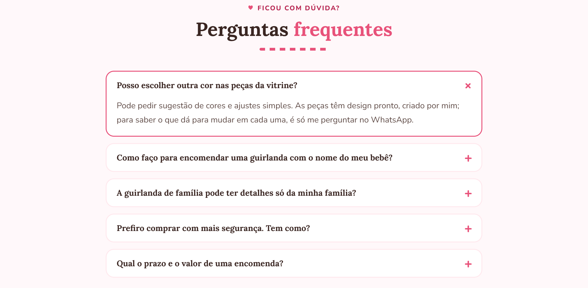
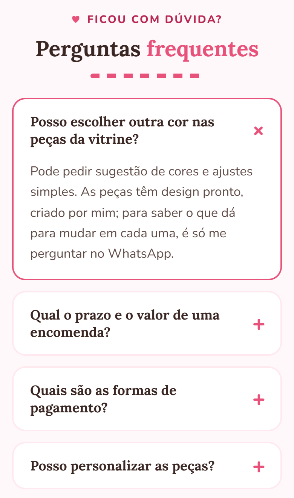
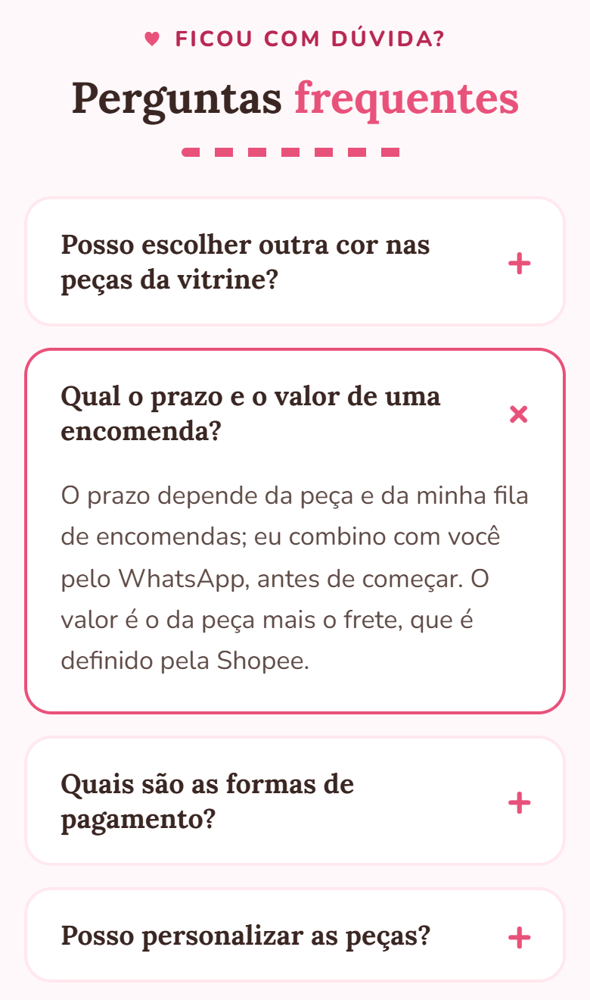
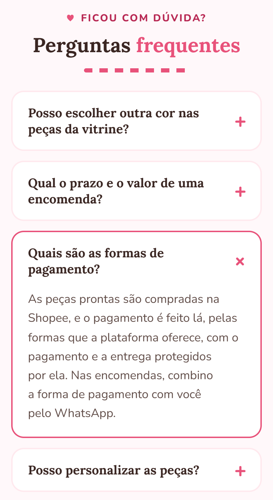
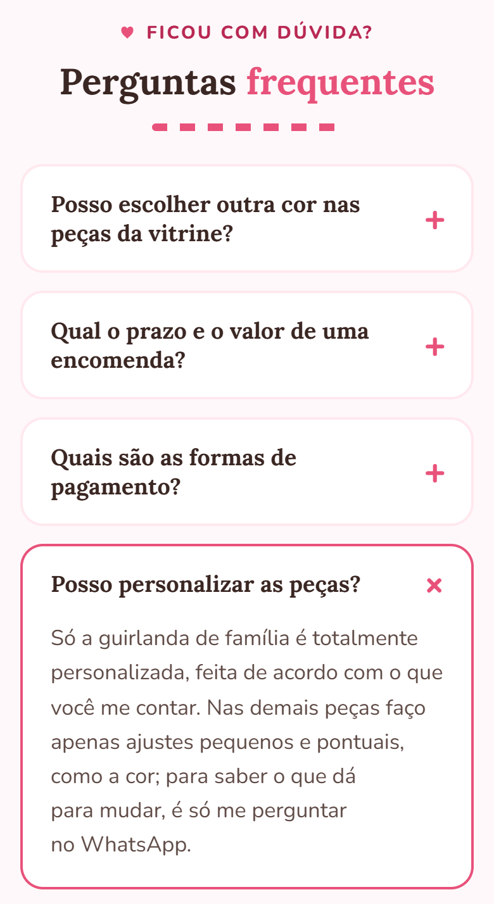

# Relatório para o avaliador: perguntas frequentes no celular

Seção nova: `index.html`, `<section id="duvidas-celular" class="faq mobile-only">`. Aparece só até 700 px. A seção do computador (`#duvidas`, `desk-only`) não foi alterada. Os estilos são os mesmos (`.faq`, `details`, `summary`, em `css/style.css:181-189`); nenhuma regra de CSS foi criada.
Prints: Edge headless, celular 390 px (escala 2x) e computador 1280 px. O cabeçalho fixo e o botão flutuante foram escondidos só na captura, para não cobrirem a seção.

## 1. Pergunta copiada do computador: "Posso escolher outra cor nas peças da vitrine?"
Comparação feita lendo o DOM das duas seções (`tests/prints-faq/info.json`, campo `textos`).

| | Texto |
|---|---|
| Pergunta (computador) | Posso escolher outra cor nas peças da vitrine? |
| Pergunta (celular) | Posso escolher outra cor nas peças da vitrine? |
| Resposta (computador) | Pode pedir sugestão de cores e ajustes simples. As peças têm design pronto, criado por mim; para saber o que dá para mudar em cada uma, é só me perguntar no WhatsApp. |
| Resposta (celular) | Pode pedir sugestão de cores e ajustes simples. As peças têm design pronto, criado por mim; para saber o que dá para mudar em cada uma, é só me perguntar no WhatsApp. |
| **Resultado** | **Idênticas, caractere por caractere** |

| Computador (1280 px) | Celular (390 px) |
|---|---|
|  |  |

### Aspecto visual: tipografia e cores (valores lidos do navegador)
| Elemento | Fonte | Peso | Cor | Computador | Celular |
|---|---|---|---|---|---|
| Sobretítulo "Ficou com dúvida?" | Nunito | 800 | `#B82853` | 14,4 px | 14,4 px |
| Título "Perguntas frequentes" | Lora (serifa) | 700 | `#3A2622` (palavra "frequentes" em `#E8527A`) | 41,6 px | 28,8 px |
| Pergunta (`summary`) | Lora | 700 | `#3A2622` | 17,92 px | 17,92 px |
| Ícone + / × | Nunito | 800 | `#E8527A` | 28,8 px | 28,8 px |
| Resposta (`p`) | Nunito | 400 | `#5F4B46` | 18 px (entrelinha 30,6) | 17 px (entrelinha 27,2) |

| Formato | Computador | Celular |
|---|---|---|
| Fundo do cartão | `#FFFFFF` | `#FFFFFF` |
| Borda aberto | 2 px `#E8527A` | 2 px `#E8527A` |
| Borda fechado | 2 px `#FFE9EE` | 2 px `#FFE9EE` |
| Raio da borda | 18 px | 18 px |
| Espaçamento interno da pergunta | 18 / 54 / 18 / 22 px | 18 / 54 / 18 / 22 px |
| Fundo da página | `#FFF8FA` | `#FFF8FA` |

**Conclusão:** famílias, pesos, cores e formato batem. As únicas diferenças são tamanhos que já mudam no modo celular da página: o título (41,6 para 28,8 px) e o texto da resposta (18 para 17 px, vindo de `body{font-size:17px}` em `@media (max-width:700px)`).

## 2. Pergunta alterada: "Qual o prazo e o valor de uma encomenda?"
Mesma pergunta; resposta nova (a do computador segue como estava).
- Computador: "Depende da peça e da minha fila de encomendas. Eu combino prazo e valor com você pelo WhatsApp, antes de começar."
- **Celular:** "O prazo depende da peça e da minha fila de encomendas; eu combino com você pelo WhatsApp, antes de começar. O valor é o da peça mais o frete, que é definido pela Shopee."

Prazo mantém a ideia original; o valor passa a ser peça + frete (definido na Shopee).

## 3. Pergunta nova: formas de pagamento
**Quais são as formas de pagamento?** As peças prontas são compradas na Shopee, e o pagamento é feito lá, pelas formas que a plataforma oferece, com o pagamento e a entrega protegidos por ela. Nas encomendas, combino a forma de pagamento com você pelo WhatsApp.

## 4. Pergunta nova: personalização
**Posso personalizar as peças?** Só a guirlanda de família é totalmente personalizada, feita de acordo com o que você me contar. Nas demais peças faço apenas ajustes pequenos e pontuais, como a cor; para saber o que dá para mudar, é só me perguntar no WhatsApp.

## Conferências automáticas (de `info.json`)
- Computador: seção `#duvidas-celular` com `display: none`.
- Celular: seção `#duvidas` (computador) com `display: none`.
- 4 perguntas no celular, na ordem: cor, prazo e valor, pagamento, personalização.

## Pontos para o avaliador conferir
- O texto sobre pagamento usa só o que a página já afirma (pagamento protegido pela Shopee). Não cita Pix, cartão ou parcelamento, porque não há essa informação no repositório.
- Os prints são de emulação a 390 px no Edge, não de aparelho físico.
