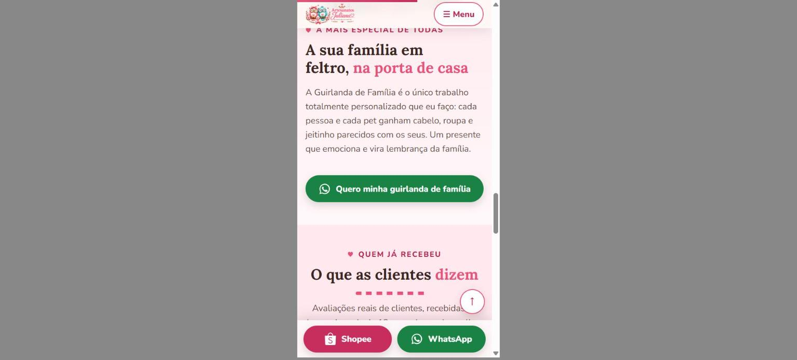
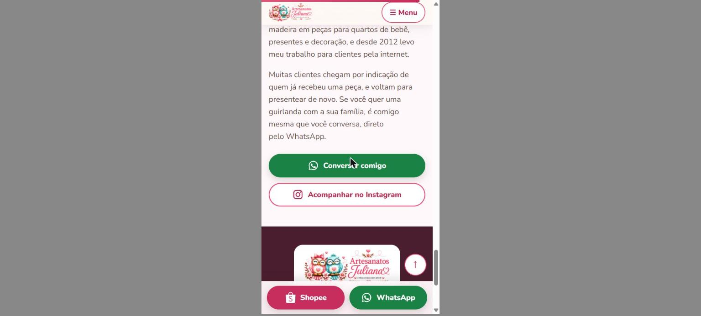
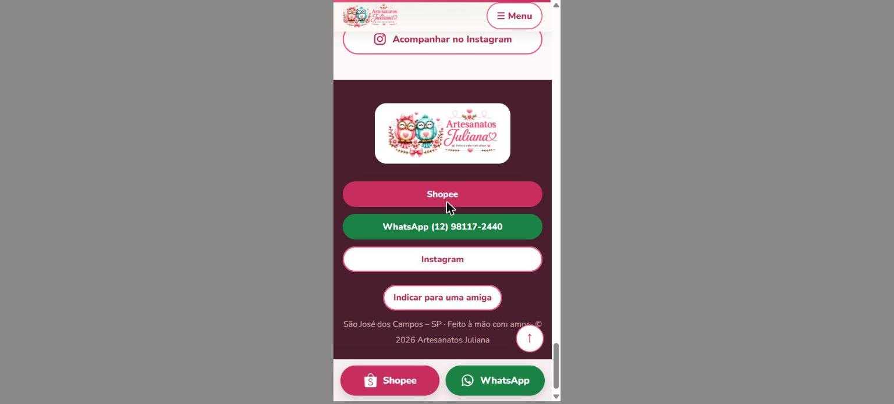
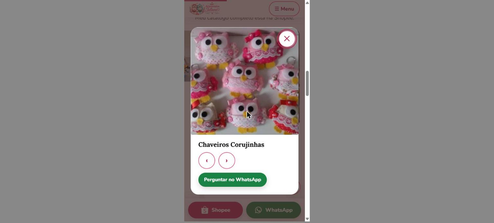
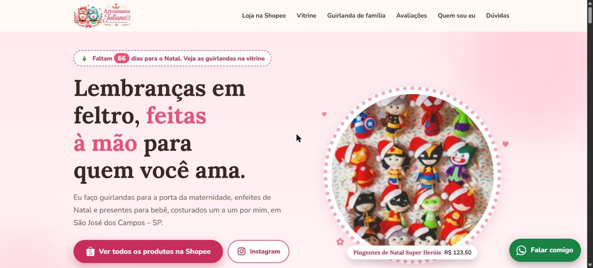
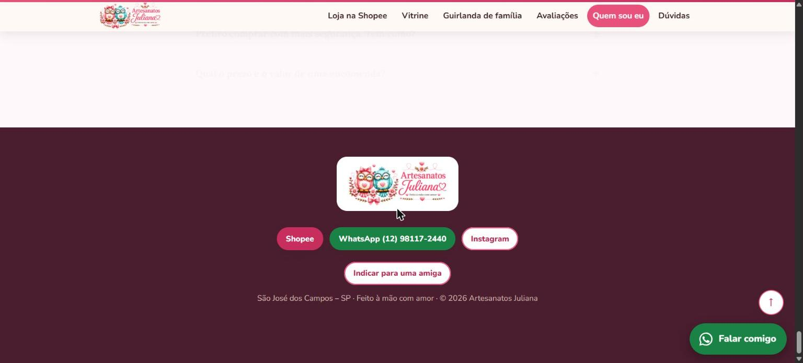

# Relatório de verificação: botão de WhatsApp (celular)

## Resultado
| Critério | Resultado |
|---|---|
| Hex adotado (para verificação) | **`#1a8244`** |
| Hex no computador = hex no celular | Sim: ambos vêm de `--wa` (`css/style.css:15`), sem sobrescrita em `@media` |
| Contraste com branco | **4,86** (exigido: 4,86; mínimo WCAG AA: 4,5) |
| Cor calculada no navegador (celular, 390 px) | `rgb(26, 130, 68)` em todos os botões visíveis, texto `rgb(255, 255, 255)` |
| Testes automatizados | 18/18 passaram (`node tests/whatsapp-color.test.js`) |

## Varredura de `--wa` (todas as pastas, exceto `.git`)
1. `css/style.css:15`: definição `--wa:#1a8244`
2. `css/style.css:40`: `.btn-wa{background:var(--wa)}`
3. `css/style.css:200`: `.fab` (botão flutuante, escondido no celular por `.fab{display:none}` na linha 440)
4. `index.html:348`: ícone do bloco "Pelo WhatsApp" (`style="background:var(--wa)"`)

No celular o botão do WhatsApp é a classe `.btn-wa` dentro de `.mbar` (barra inferior) e nos blocos da página. Não existe regra específica do celular para a cor.

## Telas em que o botão aparece no celular (390 px, iframe)
| Tela | Elemento | Print |
|---|---|---|
| Seção "Guirlanda de família" | `Quero minha guirlanda de família` (`.mobile-only`) + barra inferior |  |
| Seção "Quem sou eu" | `Conversar comigo` + barra inferior |  |
| Rodapé | `WhatsApp (12) 98117-2440` + barra inferior |  |
| Lightbox de produto | `Perguntar no WhatsApp` (`#lbGo`) |  |

Elementos com `--wa` que **não aparecem** no celular, por desenho do site: `#builderBtn` (formulário `.desk-only`), ícone e "Falar comigo" da seção `#comprar` (`.desk-only`) e `.fab` (`display:none`).

## Referência do computador (mesma cor)



## Saída dos testes
```
ok   - --wa é definido uma única vez
ok   - --wa é #1a8244 (mesmo hex para desktop e celular)
ok   - o hex é verde (canal G dominante, matiz 90°-170°)
ok   - contraste com branco = 4.86
ok   - contraste passa de 4,5 (WCAG AA)
ok   - nenhuma regra (desktop ou @media) sobrescreve a cor do WhatsApp com outro valor
ok   - .btn-wa e .fab usam var(--wa)
ok   - o botão da barra do celular (.mbar) tem a classe btn-wa
ok   - todo uso de var(--wa) no HTML/CSS está mapeado (1 definição + 3 usos)
ok   - texto dos botões é branco (#fff)
ok   - chaves do CSS balanceadas
ok   - únicas variáveis de cor alteradas desde antes da mudança: --wa
ok   - ícone #i-wa existe e é referenciado
ok   - todos os links wa.me usam o número (12) 98117-2440
ok   - links wa.me abrem em nova aba com rel=noopener
ok   - arquivos referenciados no HTML existem (css, js, assets)
ok   - js/main.js tem sintaxe válida
ok   - data/shopee-produtos.json é JSON válido

Todos os testes passaram
```
Checagem por mutação: com o hex antigo (`#1f8f4e`, contraste 4,12) e com um override de cor em `@media` no celular, os testes falham.
